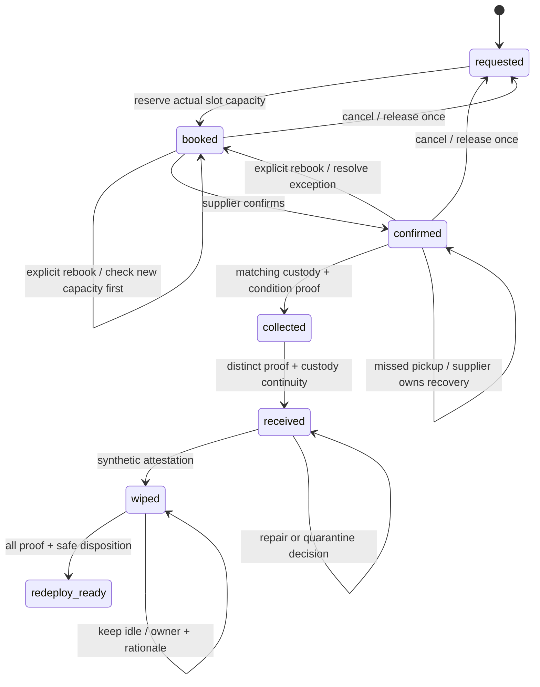

# Journey and state model

Ayo Ahmed - Independent concept

**Unofficial concept. Synthetic data. No live integrations.**

I separate workflow progress from exception ownership, condition disposition and inventory decisions. A missed pickup cannot be solved by painting the device green.

The implementation rejects silent skipping. The diagram expresses the intended journey; the [API contract](api-schema.md) is authoritative for actual commands and allowed states.

| Stage | Visible question | Accountable participant | Exit proof |
| --- | --- | --- | --- |
| Requested | Is a feasible slot available? | Operations + supplier capacity owner | Atomic reservation |
| Booked | Has the supplier accepted the plan? | Supplier | Confirmation |
| Confirmed | Did the pickup happen, and if not who recovers it? | Supplier | Collection evidence or owned exception |
| Collected | Is the correct device in the custody chain? | Supplier | Valid asset/custody identifiers and condition evidence |
| Received | Is the receiving handoff complete and condition safe? | Warehouse | Distinct linked receipt and disposition |
| Wiped | Is security readiness attested? | IT/security | Synthetic wipe attestation |
| Redeploy-ready | Is the asset available for reuse or deliberately held? | Inventory owner | All readiness gates; optional explicit idle decision |

All timestamps in this lab derive from the explicit simulation clock. Interface timezone is labelled; moving that clock changes risk and age deterministically.
